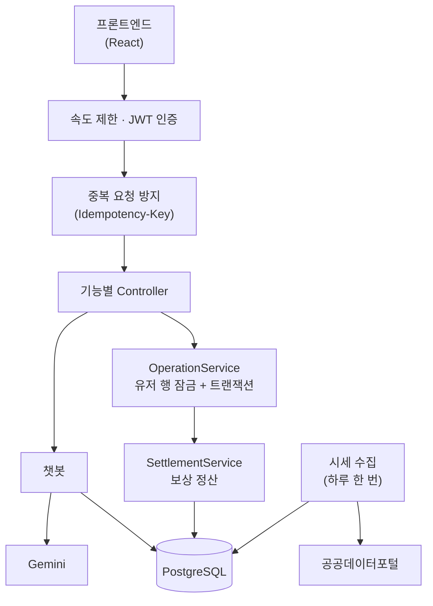

<div align="center">

# 🦁 경북 원정대 · Backend

### 지역의 이야기를 모험으로, 발견의 즐거움을 일상으로

**보상 계산부터 탐험 도우미 챗봇까지, 경북 원정대의 게임 서버**

[](https://github.com/juhyeonseok/Gyeongbug-Expedition-Backend/actions/workflows/ci.yml)


</div>

> **2026 단디톤 | RESONANCE — 우리가 대구·경북을 좋아하는 진짜 이유**

---

## 🌿 서비스 소개

**경북 원정대**는 경북의 지역과 특산물을 **캐릭터와 함께 탐험하는 게임형 지역 발견 서비스**입니다.

캐릭터는 경상북도 8개 지역을 자동으로 탐험하며 골드, 경험치, 특산물 조각을 모읍니다. 사용자는 지역 퀴즈를 풀고 특산물 도감을 채우면서 지역의 이야기를 알아가고, 탐험 도우미 챗봇에게 특산물과 시세를 물어볼 수 있습니다.

이 저장소는 그 서비스의 **백엔드 서버**입니다. 로그인 없이 캐릭터 이름만 정하면 바로 시작할 수 있고, 게임의 모든 보상은 서버가 계산합니다.

| 구분 | 저장소 |
| --- | --- |
| 백엔드 (이 저장소) | <https://github.com/juhyeonseok/Gyeongbug-Expedition-Backend> |
| 프론트엔드  | <https://github.com/parkjinacosmos/Gyeongbuk-Expedition-Frontend> |

> 서비스의 기획 배경과 화면 소개는 프론트엔드 저장소의 README 에 있습니다. API 명세와 게임 규칙 원문 같은 기획 문서는 팀이 따로 보관하며, 코드 주석의 `GAME_RULES`, `API`, `DATABASE`, `ARCHITECTURE` 는 그 문서를 가리킵니다.


## 🎮 Game Rules

| 항목 | 규칙 |
| --- | --- |
| **몹 처치 보상** | 탐험 4초마다 몹 1마리를 자동으로 처치하고 골드와 경험치를 얻습니다 |
| **방치 보상** | 게임을 꺼 둔 시간도 최대 8시간까지 서버가 계산합니다 |
| **특산물 조각** | 몹마다 지역별 확률(0.30~0.60%)로 떨어지고, 300마리 연속으로 실패하면 다음 몹은 반드시 조각을 줍니다 |
| **지역 해금** | 조각 20개를 모으면 다음 지역이 열립니다 |
| **성장** | 레벨은 최대 20이고, 골드를 사용해 장비를 5단계까지 강화합니다 |
| **일일 퀴즈** | 현재 지역의 3문항을 하루에 한 번 풉니다. 제출하면 정답 수와 관계없이 100골드와 20XP를 받습니다 |

### 탐험 지역

| 순서 | 지역 | 특산물 | 조각 확률 | 상태 |
| :---: | --- | --- | :---: | --- |
| 1 | 청송 | 사과 | 0.60% | ✅ 플레이 가능 |
| 2 | 안동 | 간고등어 | 0.55% | ✅ 플레이 가능 |
| 3 | 영주 | 풍기인삼 | 0.50% | 🔒 수치만 준비 |
| 4 | 문경 | 오미자 | 0.45% | 🔒 수치만 준비 |
| 5 | 상주 | 곶감 | 0.40% | 🔒 수치만 준비 |
| 6 | 성주 | 참외 | 0.36% | 🔒 수치만 준비 |
| 7 | 의성 | 마늘 | 0.33% | 🔒 수치만 준비 |
| 8 | 포항 | 과메기 | 0.30% | 🔒 수치만 준비 |

---

## ✨ Key Features

### 👤 01. 체험 계정

- 로그인 없이 캐릭터 이름만으로 시작
- JWT 발급과 만료 전 연장
- 이름 길이·문자·금칙어·중복 검사

### 🎁 02. 방치 보상 정산

- DB 시각 기준의 경과 시간 계산과 8시간 상한
- 골드·경험치·몹 처치 수·특산물 조각 계산
- 수령 전 미리보기와 수령 처리

### ⚔️ 03. 캐릭터 성장

- 레벨 공식과 레벨별 골드 보너스
- 장비 5단계 강화, 부족한 조건(`GOLD`, `LEVEL`) 안내

### 🗺️ 04. 지역 탐험

- 지역 목록과 잠금·해금 상태 조회
- 조각을 모아 다음 지역으로 이동

### 🧩 05. 오늘의 퀴즈

- 현재 지역의 3문항 발급 (하루 한 번, 한국 날짜 기준)
- 정답과 해설 제공, 제출 보상 지급

### 📖 06. 특산물 도감과 지역 상품

- 지역별 특산물 도감 조회
- 지역 상품 목록과 상세 조회

### 🤖 07. 탐험 도우미 AI

- 게임 규칙, 특산물, 시세 질문에 답변
- 공공데이터포털의 농수산물 가격을 하루 한 번 수집
- Gemini 가 문장을 다듬고, 검사를 통과한 답변만 사용
- 사용자당 하루 100회, 서비스 전체 하루 1,000회 제한

> **구현 범위 안내:** 지금 플레이할 수 있는 지역은 청송과 안동입니다. 두 지역의 소개와 퀴즈는 초안이며 사실 검수를 마치지 않았습니다. 나머지 6개 지역의 콘텐츠, 판매처 링크와 상품 이미지, 주문 기능은 아직 없습니다.

---

## 📡 API

기본 주소는 `/api/v1` 이고, 캐릭터 생성과 `/health` 를 제외한 모든 API 는 `Authorization: Bearer <jwt>` 헤더가 필요합니다. 🔑 표시는 `Idempotency-Key` 헤더가 필수인 API 입니다.

| 분류 | Method | Path | 설명 |
| --- | --- | --- | --- |
| 유저 | `POST` | `/user` | 캐릭터 생성과 토큰 발급 |
| | `POST` | `/user/refresh` | 토큰 연장 |
| | `GET` | `/user` | 내 캐릭터 조회 |
| 방치 보상 | `GET` | `/idle-reward` | 보상 미리보기 |
| | `POST` | `/idle-reward` | 🔑 보상 수령 |
| 장비 | `GET` | `/equipment` | 장비와 강화 조건 조회 |
| | `POST` | `/equipment/upgrade` | 🔑 장비 강화 |
| 지역 | `GET` | `/regions` | 지역 목록과 해금 상태 |
| | `POST` | `/regions/move` | 🔑 지역 이동 |
| 퀴즈 | `POST` | `/quiz/today` | 오늘의 퀴즈 발급 |
| | `GET` | `/quiz/today` | 오늘의 퀴즈 조회 |
| | `POST` | `/quiz/submit` | 🔑 퀴즈 제출 |
| 도감 | `GET` | `/codex` | 특산물 도감 목록 |
| | `GET` | `/codex/:specialty_id` | 특산물 상세 |
| 상품 | `GET` | `/products` | 지역 상품 목록 |
| | `GET` | `/products/:product_id` | 상품 상세 |
| 챗봇 | `POST` | `/chat` | 탐험 도우미에게 질문 |
| 기록 | `POST` | `/progress/reset` | 🔑 체험 기록 초기화 |
| 요청 확인 | `GET` | `/operations/:key` | `Idempotency-Key` 처리 결과 조회 |
| 상태 | `GET` | `/health` | 서버와 DB 상태 (`/api/v1` 없이 호출) |

요청과 응답의 전체 형식은 서버를 실행한 뒤 Swagger(<http://localhost:3000/docs>)에서 확인합니다.

---

## 🛠 Tech Stack

| Category | Technology | Usage |
| --- | --- | --- |
| Core | Node.js, TypeScript, NestJS 11 | 모듈 기반 API 서버 |
| Database | PostgreSQL 15, TypeORM 0.3 | 스키마 마이그레이션과 트랜잭션·행 잠금 |
| Auth | JWT (Bearer 헤더), Passport | 체험 계정 인증 |
| Validation | class-validator, Joi | 요청 본문과 환경 변수 검증 |
| Security | Helmet, Throttler | 보안 헤더와 속도 제한 |
| Docs | Swagger | API 문서와 테스트 화면 |
| AI · Data | Gemini, 공공데이터포털 | 챗봇 문장 생성과 특산물 시세 |
| Test | Jest, Supertest, Testcontainers | 단위 테스트 191개, 통합 테스트 147개 |
| CI | GitHub Actions | 린트, 단위·통합 테스트, 빌드, 의존성 감사, Docker 빌드 |
| Deploy | Docker | 운영 이미지 (`Dockerfile`) |

---

## 🏗 Architecture



- **정산은 한 서비스에서 합니다.** 보상 수령, 장비 강화, 지역 이동, 퀴즈 제출은 모두 `SettlementService` 를 거치며, 게임 수치와 공식은 `modules/settlement` 에만 있습니다.
- **시각은 DB 가 정합니다.** 정산 시각은 트랜잭션 안에서 DB 의 현재 시각으로 구하고, 서버는 `TZ=UTC` 로 실행합니다.
- **검사에 실패하면 전부 되돌립니다.** 골드 부족 같은 검사 실패는 정산까지 함께 롤백합니다.
- **추첨은 주입합니다.** 조각 추첨 함수는 주입할 수 있어, 테스트에서 고정된 순서로 규칙 검수 사례를 재현합니다.
- **AI 가 없어도 동작합니다.** 챗봇 키가 비어 있으면 시세 수집과 AI 호출 없이 정해진 답변으로 응답합니다.

---

## 📁 Project Structure

```text
src/
├── main.ts                 # 서버 시작점
├── app.module.ts           # 전체 모듈 조립, 환경 변수 검증
├── app.setup.ts            # CORS, 입력 검증, 오류 처리, Swagger 설정
├── common/                 # 오류 코드, 데코레이터, 공통 함수, Swagger 정의
├── config/                 # DB 연결 설정
├── database/
│   ├── entities/           # 테이블 정의
│   ├── migrations/         # 테이블 변경 이력
│   └── seeds/              # 초기 데이터와 퀴즈 문항
└── modules/                # 기능별 코드
    ├── settlement/         # 보상 계산 (게임 수치와 공식은 여기에만 있습니다)
    ├── operation/          # 중복 요청 방지 (Idempotency-Key)
    ├── auth/               # 캐릭터 생성, 인증, 속도 제한
    ├── user/               # 유저 조회
    ├── idle-reward/        # 방치 보상
    ├── equipment/          # 장비 강화
    ├── region/             # 지역 조회와 이동
    ├── quiz/               # 오늘의 퀴즈
    ├── codex/              # 특산물 도감
    ├── product/            # 지역 상품
    ├── chat/               # 탐험 도우미 챗봇, 특산물 시세 수집
    └── progress/           # 체험 기록 초기화

test/                       # 통합 테스트
static/                     # 이미지 파일 (/static 주소로 제공)
scripts/                    # 환경 변수 파일 생성 스크립트
```

기능을 고칠 때는 `modules/` 의 해당 폴더에서 `*.controller.ts` 부터 보면 요청이 어떻게 처리되는지 따라갈 수 있습니다.

---

## 🚀 Getting Started

### 0. 준비물

데이터베이스는 Docker 가 띄워 주므로 PostgreSQL 을 따로 설치할 필요가 없습니다.

| 프로그램 | 버전 | 확인 명령 |
| --- | --- | --- |
| [Node.js](https://nodejs.org/) | 22.22 이상 (24 LTS 권장) | `node --version` |
| [Docker Desktop](https://www.docker.com/products/docker-desktop/) | 최신 | `docker --version` |

> Docker Desktop 은 설치만으로는 부족합니다. **프로그램을 실행해 둔 상태**여야 다음 단계가 동작합니다.

### 1. 저장소 클론

```bash
git clone https://github.com/juhyeonseok/Gyeongbug-Expedition-Backend.git
cd Gyeongbug-Expedition-Backend
```

### 2. 의존성 설치

```bash
npm ci
```

### 3. 환경 변수 설정

다음 명령이 `.env` 파일을 만들고 DB 비밀번호와 서명 키를 무작위로 채웁니다. 이 값은 내 컴퓨터에만 저장되고 저장소에는 올라가지 않습니다. 이미 `.env` 가 있으면 그대로 둡니다.

```bash
npm run setup:env
```

### 4. 데이터베이스 실행

PostgreSQL 컨테이너를 띄웁니다. 처음에는 이미지를 내려받느라 1~2분 걸릴 수 있습니다. `Healthy` 가 나오면 준비된 것입니다.

```bash
docker compose up -d --wait
```

### 5. 테이블과 초기 데이터 만들기

```bash
npm run migration:run
npm run seed
```

`migration:run` 은 테이블을 만들고, `seed` 는 지역, 특산물, 장비 강화표, 청송·안동의 퀴즈를 넣습니다. 끝에 `시드를 적용했습니다.` 가 나오면 성공입니다.

### 6. 개발 서버 실행

```bash
npm run start:dev
```

`Nest application successfully started` 가 보이면 켜진 것입니다. 코드를 저장하면 서버가 자동으로 다시 시작합니다.

### 7. 동작 확인

| 주소 | 확인할 내용 |
| --- | --- |
| <http://localhost:3000/health> | `{"status":"ok","config_version":"v1.2"}` 이 보이면 서버와 DB 가 정상입니다 |
| <http://localhost:3000/docs> | API 문서와 테스트 화면(Swagger)이 열립니다 |

### 다음부터 실행할 때

Docker Desktop 을 실행하고 두 명령만 입력하면 됩니다.

```bash
docker compose up -d --wait
npm run start:dev
```

`git pull` 로 코드를 받은 뒤에는 서버를 켜기 전에 다음도 실행합니다. 패키지와 테이블이 바뀌었을 수 있습니다.

```bash
npm ci
npm run migration:run
npm run seed
```

> `seed` 는 중복 행을 만들지 않지만 관리 중인 콘텐츠를 코드 값으로 갱신합니다. DB 에서 직접 수정한 소개·문항이 있다면 먼저 차이를 확인합니다. 기존 지역의 활성 여부는 바꾸지 않습니다.

### 탐험 도우미 챗봇 켜기 (선택)

`.env` 의 다음 값을 채우고 서버를 다시 시작합니다. 비어 있으면 시세 수집과 AI 호출 없이 정해진 답변으로 동작합니다.

| 변수 | 설명 |
| --- | --- |
| `DATA_GO_KR_SERVICE_KEY` | 공공데이터포털 서비스 키. 특산물 시세를 수집합니다 |
| `AI_API_KEY` | Gemini API 키. 답변 문장을 다듬습니다 |
| `AI_MODEL` | 사용할 Gemini 모델 이름 |

---

## 🧪 API 써 보기

코드를 작성하지 않아도 <http://localhost:3000/docs> 에서 직접 호출할 수 있습니다.

1. `POST /api/v1/user` 를 펼치고 **Try it out** 을 누릅니다.
2. 본문에 `{ "name": "테스트유저" }` 를 넣고 **Execute** 를 누릅니다. 이름은 2~10자의 한글, 영문, 숫자이며 다른 유저와 겹치면 안 됩니다.
3. 응답의 `jwt` 값을 복사합니다.
4. 화면 위쪽의 **Authorize** 를 누르고 복사한 값을 붙여 넣습니다. 이제 다른 API 를 호출할 수 있습니다.
5. `GET /api/v1/user` 로 내 캐릭터를 조회해 봅니다.

보상 수령처럼 상태를 바꾸는 API 에는 `Idempotency-Key` 칸이 있습니다. [UUID 생성기](https://www.uuidgenerator.net/version4)로 만든 값을 넣습니다. 방금 만든 캐릭터는 60초가 지나야 보상을 받을 수 있습니다.

---

## 🤝 프론트엔드 연동 가이드

| 항목 | 내용 |
| --- | --- |
| **기본 주소** | `http://localhost:3000/api/v1` |
| **CORS** | 기본으로 `http://localhost:5173` 만 허용합니다. 다른 주소는 `.env` 의 `CORS_ORIGIN` 에 쉼표로 추가하고 서버를 다시 시작합니다 |
| **인증** | `POST /user` 응답의 `jwt` 를 보관했다가 `Authorization: Bearer <jwt>` 헤더로 보냅니다 |
| **토큰 삭제** | **`401` 일 때만** 토큰을 지웁니다. `500`, `429`, 네트워크 실패는 일시적인 문제이므로 토큰을 유지합니다 |
| **`Idempotency-Key`** | 요청마다 UUID v4 를 새로 만들고, **같은 요청을 재시도할 때는 같은 값**을 보냅니다 |
| **오류 처리** | 오류 본문은 `{ code, message, details }` 입니다. 화면 분기는 `message` 가 아니라 `code` 로 합니다 |
| **시간** | 기기 시각이 아니라 응답의 `server_time` 을 기준으로 계산합니다 |

<details>
<summary><b>장비 강화와 입력 검증의 세부 규칙</b></summary>

<br/>

- **장비 강화:** `GET /equipment` 의 `blocked_by` 는 항상 배열입니다. 골드와 레벨이 모두 부족하면 `["GOLD", "LEVEL"]`, 강화할 수 있으면 `[]` 입니다. `POST /equipment/upgrade` 는 정산 후 둘 다 부족하면 409 `EQUIPMENT_REQUIREMENTS_NOT_MET` 를 반환하고 정산도 롤백합니다. 하나만 부족할 때의 오류 코드는 그대로 유지됩니다.
- **입력 검증:** 요청 본문과 쿼리의 정수 필드에 문자를 넣으면 `VALIDATION_ERROR` 의 `details.reason` 은 `정수만 입력할 수 있습니다.` 입니다. 필수·타입 오류를 범위 오류보다 먼저 안내합니다. 닉네임 검증도 같은 오류 코드이며 `reason` 은 `LENGTH`·`CHARSET`·`BANNED_WORD` 입니다. 경로 ID 의 `ParseIntPipe` 오류 문구는 별도입니다.

</details>

---

## 📜 Scripts

| Command | Description |
| --- | --- |
| `npm run start:dev` | 개발 서버 실행. 코드를 저장하면 다시 시작합니다 |
| `npm run build` | 운영용 빌드. 결과는 `dist/` 에 생깁니다 |
| `npm run lint` | 코드 검사와 자동 수정 |
| `npm run test` | 단위 테스트. Docker 가 필요 없습니다 |
| `npm run test:integration` | API 통합 테스트. Docker Desktop 이 켜져 있어야 하며 개발 DB 는 건드리지 않습니다 |
| `npm run setup:env` | `.env` 가 없을 때 새로 만들고 비밀 값을 무작위로 채웁니다 |
| `npm run migration:run` | 아직 적용되지 않은 테이블 변경을 적용 |
| `npm run seed` | 마스터·관리 콘텐츠 적용. 중복 행은 없지만 기존 콘텐츠 일부를 코드 값으로 갱신 |
| `docker compose up -d --wait` | 개발 DB 켜기 |
| `docker compose down` | 개발 DB 끄기. 데이터는 남습니다 |
| `docker compose down -v` | 개발 DB 끄고 **데이터까지 삭제** |

<details>
<summary><b>개발 데이터를 모두 지우고 다시 시작하기</b></summary>

<br/>

**개발 데이터를 모두 폐기하기로 한 경우에만** 실행합니다. 지금까지 만든 캐릭터가 모두 사라집니다. 일반적인 오류 해결 절차가 아니며, 보존할 데이터가 있으면 백업과 별도 이행 작업이 먼저입니다.

```bash
docker compose down -v
docker compose up -d --wait
npm run migration:run
npm run seed
```

</details>

---

## 🩺 Troubleshooting

| 증상 | 원인과 해결 |
| --- | --- |
| `docker` 명령에서 `cannot connect`, `pipe` 오류 | Docker Desktop 실행 상태, 선택한 Docker context, 엔진 접근 권한을 확인합니다. `docker info` 가 성공해야 합니다 |
| `port is already allocated` (5433) | 다른 프로그램이 5433 을 쓰고 있습니다. `.env` 의 `POSTGRES_PORT` 와 `DATABASE_URL` 의 포트를 같은 값으로 바꿉니다 |
| `EADDRINUSE` (3000) | 서버가 이미 켜져 있거나 다른 프로그램이 3000 을 씁니다. `.env` 의 `PORT` 와 `PUBLIC_BASE_URL` 을 바꿉니다 |
| `Config validation error` | 오류에 표시된 변수의 누락·형식을 확인해 해당 값만 고칩니다. `.env` 가 없는 새 환경에서만 `npm run setup:env` 로 만듭니다. 기존 파일과 JWT 키를 임의로 지우거나 다시 만들지 않습니다 |
| `password authentication failed` | 접속 대상과 DB 의 실제 비밀번호가 `.env` 와 일치하는지 확인합니다. 기존 DB 는 `.env` 수정만으로 비밀번호가 바뀌지 않습니다. 데이터 삭제로 해결하지 말고 접속 설정을 먼저 맞춥니다 |
| `relation "users" does not exist` | 테이블이 없습니다. `npm run migration:run` 을 실행합니다 |
| 스키마 오류가 나거나 `migration:run` 이 실패 | 실제 오류와 적용된 migration 을 확인합니다. 초기 개발 중 `InitSchema` 를 직접 고친 이력이 있어 구버전 DB 는 별도 이행이 필요할 수 있습니다. DB 삭제를 기본 해결책으로 사용하지 않습니다 |
| 브라우저 콘솔의 CORS 오류 | 프론트엔드  주소가 허용 목록에 없습니다. `.env` 의 `CORS_ORIGIN` 에 추가하고 서버를 다시 시작합니다 |
| `POST /quiz/today` 가 `QUIZ_NOT_AVAILABLE` | 현재 지역에 활성 문항이 3개 이상 있는지 확인합니다. 청송·안동의 기본 문항이 없다면 시드를 적용합니다. 나머지 6개 지역은 아직 문항이 없습니다 |
| `POST /user` 가 `429` | 개발 중 캐릭터를 시간당 10개 넘게 만들었습니다. `.env` 의 `THROTTLE_CREATE_USER_PER_IP_PER_HOUR` 를 늘리고 서버를 다시 시작합니다 |
| 통합 테스트가 시작 전에 실패 | Docker 접근, 이미지 내려받기, 포트·권한과 최초 오류를 확인합니다 |

> **알려진 제약:** 체험 계정은 토큰을 잃으면 복구할 수 없고, 유효한 토큰은 만료 전에 반복해서 연장할 수 있습니다. 속도 제한은 단일 프로세스의 메모리를 사용합니다. 로그에는 접속 IP 주소가 포함될 수 있어 수집·보관 정책 확인이 필요합니다.

---

## 🔐 비밀 값 관리

- `.env` 는 커밋하지 않습니다. `.gitignore` 에 들어 있습니다.
- `.env.example` 에는 변수 이름과 비밀이 아닌 기본값만 적습니다. 비밀번호, 키, 토큰은 임시 값이라도 적지 않습니다.
- 비밀 값을 팀원에게 전달할 일이 생기면 저장소나 메신저 대신 비밀 공유 도구를 씁니다.

---

## 🚢 Deployment

`Dockerfile` 로 운영 이미지를 만듭니다. 시연 서버는 Docker Compose 와 Caddy 로 실행하며, 그 구성 파일은 이 저장소에 포함하지 않습니다. 정식 운영을 위한 호스팅, 도메인, DB 백업은 아직 정하지 않았습니다.

```bash
docker build -t gyeongbug-server .
docker run --rm --env-file .env gyeongbug-server npm run -s migration:run:prod
docker run --rm --env-file .env gyeongbug-server npm run -s seed:prod
docker run -d -p 3000:3000 --env-file .env gyeongbug-server
```

위 명령의 `.env` 는 컨테이너에서 접근할 수 있는 운영 DB 주소를 가진 파일을 뜻합니다. 로컬 개발용 `localhost:5433` 설정을 그대로 사용하지 않습니다.

| 항목 | 설정 |
| --- | --- |
| 운영 값 | 서명 키, DB 접속 정보, `CORS_ORIGIN`, `PUBLIC_BASE_URL` 을 호스팅의 환경 변수나 비밀 저장소에 넣습니다 |
| 운영 모드 | `NODE_ENV=production`, `SWAGGER_ENABLED=false` |
| DB SSL | DB 가 SSL 을 쓰면 `DATABASE_SSL=true`, 사설 인증서라면 `DATABASE_SSL_CA` 도 넣습니다. `DATABASE_URL` 에 `sslmode=require` 가 있는데 `DATABASE_SSL=false` 면 서버가 뜨지 않습니다 |
| 프록시 | 프록시 뒤에 배포하면 `TRUST_PROXY_HOPS` 를 프록시 단계 수로 설정합니다 |

---

## 🤖 AI 활용

**서비스 안의 AI:** 탐험 도우미 챗봇(`POST /api/v1/chat`)이 Gemini 를 사용합니다. AI 는 서버가 넘겨준 게임 규칙·특산물·시세 자료 안에서만 답하고, 시세 숫자는 공공데이터에서 저장한 값만 사용합니다.

**개발 과정의 AI:** AI 코딩 도구(ChatGPT 계열, Claude Code)를 사용했습니다.

| 구분 | 내용 |
| --- | --- |
| AI 가 맡은 일 | 이미지로 받은 기획 자료 정리, 설계 문서 초안, API·정산 로직·마이그레이션·테스트 구현, 팀 ERD 와 설계 문서 대조, 코드 리뷰, 배포 구성 |
| 사람이 결정한 일 | 게임 규칙과 수치, 기술 스택, 구현 우선순위, 몹 처치 보상의 해석 방식, 병합과 배포 |
| 결과 검증 | 자동 테스트와 CI, 코드 리뷰 지적 사항 수정, 시연 서버의 실제 API 호출 확인 |

---

## 📝 Commit Convention

[Conventional Commits](https://www.conventionalcommits.org/) 형식을 사용합니다. 개발은 `develop` 브랜치에서 진행하고 PR 로 `main` 에 병합합니다.

```text
<type>: <subject>
```

| Type | 설명 |
| --- | --- |
| `feat` | 새로운 기능 추가 |
| `fix` | 버그 수정 |
| `refactor` | 동작 변경 없는 코드 구조 개선 |
| `docs` | 문서 추가 또는 수정 |
| `test` | 테스트 추가 또는 수정 |
| `chore` | 설정·패키지 등 기타 작업 |

---

## 📄 License

별도의 오픈소스 라이선스를 적용하지 않았습니다. 코드는 열람할 수 있지만, 재사용하려면 팀의 허락이 필요합니다.

---

<div align="center">

**지역에서 시작한 즐거움이, 더 많은 사람의 일상 속 새로운 발견으로 이어지도록.**

</div>
